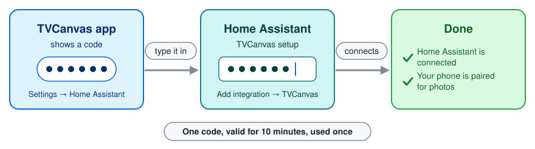

# TVCanvas for Home Assistant

The Home Assistant companion of [TVCanvas](https://tvcanvas.app), the iPhone app that puts
art, photos and live dashboards on your TV. It keeps your TVs showing your TVCanvas pins, day
and night, without your phone.

[](https://my.home-assistant.io/redirect/hacs_repository/?owner=DanielLandi&repository=tvcanvas-ha&category=integration)
[](https://my.home-assistant.io/redirect/config_flow_start/?domain=tvcanvas)

## How it works


- In the TVCanvas iPhone app you pin a board, a collection, webcams, a custom image or an
  art group to a TV, and switch on **Run on Home Assistant**.
- Home Assistant picks the pin up from TVCanvas Cloud and keeps the TV updated over your
  home network, even when your phone is off or away.
- Photos from your phone go straight to Home Assistant over your home Wi-Fi, never through
  the cloud.
- You still choose what plays in the app, and it shows when Home Assistant last updated
  each TV.

## What you need

- **Home Assistant 2026.9 or newer**, with internet access.
- **The TVCanvas iPhone app**, signed in, with Home Assistant support
  (Settings → Home Assistant).
- **A Samsung The Frame** (Art Mode; tested on the 2022 model, 2024 and newer are best
  effort) **or a Google Cast TV** (Chromecast, Google TV, TVs with Cast built in), on the same
  network as Home Assistant.

Board pins use credits, as on the phone (a board refreshed every 5 minutes costs about 5.8
credits a day). Collections, webcams, custom images and photos don't.

## Set up in 3 steps



1. **Install.** Click the first button above, select **Download**, then restart Home
   Assistant. On 2026.11 or newer it opens Settings → Marketplace; on 2026.9 or 2026.10,
   install [HACS](https://www.hacs.xyz/docs/use/download/download/) first.
2. **Type the code.** In the app, go to **Settings → Home Assistant → Connect Home
   Assistant**. It shows a 12-character code like `K7QM-2XRA-P4NB`, valid for 10 minutes.
   Click the second button above (or **Settings → Devices & services → Add integration →
   TVCanvas**) and type the code. This also pairs your phone for photos.
3. **Done.** In the app, open a TV's pin and switch on **Run on Home Assistant**. Home
   Assistant takes over within a minute.

**Samsung Frame, first time only:** the TV asks you to allow *TVCanvas-HA*. Press **Allow**
with the remote within 60 seconds.

**Google Cast:** the TV loads images from Home Assistant, so set Home Assistant's local
address under **Settings → System → Network**.

No button, or installing by hand? See
[Installing without the button](docs/troubleshooting.md#installing-without-the-button).

## What you get

- **A device per TV** with a **Last update** sensor (when the last image was shown, and the
  latest status in its `last_error` attribute) and controls for your dashboards: see what's
  on the TV, pick another item, pause, skip, or preview an item first ([Entities](#entities)).
- **A TVCanvas device** with a **Paired phones** sensor: the phones that may send photos.
- **On a Frame**, images go to My Photos with no mat. With *Replace previous* on, Home
  Assistant deletes the image it showed before, never your own art.
- **It waits politely:** while a Frame shows TV, runs its own slideshow or is in standby,
  nothing is uploaded and no credits are spent.
- **It keeps going** when TVCanvas Cloud is down (boards wait; everything else carries on)
  and picks a TV up again as soon as it's back.

You still choose each TV's pin in the app; Home Assistant moves only within it. Collages, picture-in-picture and overlays are drawn by the phone, so Home Assistant shows
the images without them; Photos albums stay on the phone
([what each pin shows](docs/troubleshooting.md#what-each-pin-shows)).

## Entities

Each TV is a device with these entities (`<tv>` is the TV's name, like `living_room`):

| Entity | What it does |
|---|---|
| **Last update** `sensor.<tv>_last_update` | When the last image was shown. The `last_error` attribute holds the latest status |
| **Now showing** `select.<tv>_now_showing` | The item on the TV: a board, a collection image, a webcam, a link or a phone photo, by name. Pick another to show it now; the rotation carries on from there |
| **Current image** `image.<tv>_current_image` | The image the TV shows, for a picture card |
| **Pause rotation** `switch.<tv>_pause_rotation` | On: the TV keeps its current item and Home Assistant leaves the TV alone. Off: the rotation resumes at the next refresh. It stays on after a restart. You can still pick an item or press **Next image**; the TV then stays paused on it |
| **Next image** `button.<tv>_next_image` | Shows the next item now, as the next refresh would |
| **Preview** `select.<tv>_preview` | Pick an item to see it in **Preview image** first. The TV is not touched |
| **Preview image** `image.<tv>_preview_image` | The item picked in **Preview** |
| **Show preview on TV** `button.<tv>_show_preview_on_tv` | Sends the previewed item to the TV, with the same image |

The **TVCanvas** device has a **Paired phones** sensor: the phones that may send photos.

Previews of phone photos, webcams, links and collection images are free. **Previewing a
board renders it, which uses 1 credit**, as on the phone (sending that preview to the TV
doesn't use another). A board preview is refused while a Frame is in standby, and you can
preview at most one board every 30 seconds per TV. Picking a board in **Now showing**, or
**Next image** on a board, renders it too and uses a credit.

The images of your phone's photos, in **Current image** and **Preview image**, are shown
only to devices on your home network: from outside (Home Assistant Cloud's remote access,
port forwarding) they show as a broken picture.

The app shows what Home Assistant has on each TV, and whether it's paused.

## Automations

Pause the living room TV while a movie plays, and carry on afterwards:

```yaml
automation:
  - alias: Hold the TV image during a movie
    triggers:
      - trigger: state
        entity_id: media_player.living_room
        to: playing
    actions:
      - action: switch.turn_on
        target:
          entity_id: switch.living_room_pause_rotation
  - alias: Carry on after the movie
    triggers:
      - trigger: state
        entity_id: media_player.living_room
        from: playing
        for: "00:02:00"
    actions:
      - action: switch.turn_off
        target:
          entity_id: switch.living_room_pause_rotation
```

Show the weather every morning at 7 (the option is the item's name in **Now showing**):

```yaml
automation:
  - alias: Weather at breakfast
    triggers:
      - trigger: time
        at: "07:00:00"
    actions:
      - action: select.select_option
        target:
          entity_id: select.living_room_now_showing
        data:
          option: Weather Dashboard
```

A wall switch or remote button that skips to the next image:

```yaml
automation:
  - alias: Next image from the wall switch
    triggers:
      - trigger: state
        entity_id: event.hallway_switch_button_1
    actions:
      - action: button.press
        target:
          entity_id: button.living_room_next_image
```

## Privacy and security

- **Your photos stay home.** They go from your phone to Home Assistant over your home
  network only. They are part of Home Assistant's backups.
- **Home Assistant never sends photos or images to TVCanvas Cloud**, nor your TVs'
  addresses: only a check for new pins and a short status per refresh, with the name of
  what each TV shows so the app can show it too.
- **Images go only to TVs on your home network.** Home Assistant refuses any TV address
  that isn't private, and its image and photo addresses answer only your home network.
- **A TV that moves to a new address** is followed only after Home Assistant has checked
  it's the same TV, and a notification tells you.
- **A Frame in standby pauses:** no board renders, so no credits are spent.
- **Removing the integration** deletes its pins, Frame permissions, phone keys and photos.

Everything that is sent, fetched and kept: [docs/privacy.md](docs/privacy.md).

## Troubleshooting

Check the TV's **Last update** sensor: its `last_error` attribute holds the latest status.

| You see | What to do |
|---|---|
| `waiting: Watch TV` | Nothing. The Frame updates when you're back in Art Mode |
| `waiting: Art` | Stop the Frame's own slideshow, or pick TVCanvas mode in the app |
| `waiting: photos N` | Open the app on your home Wi-Fi; it sends the missing photos. If the app says photos aren't set up, remove this Home Assistant in the app and connect again |
| `TV unreachable: …` | Check the TV's power and network. If its address changed, Home Assistant follows it once it has checked it's the same TV, and a notification says so. A fixed IP address in your router avoids this |
| `TV did not load the image` or `no local URL a Cast TV can reach` | Set Home Assistant's local address under Settings → System → Network |
| `out of credits` | Top up in the app. Boards retry every 30 minutes |
| *TVCanvas Cloud didn't accept this code* | Get a new code in the app (it works once, for 10 minutes) |
| *Could not reach TVCanvas Cloud* or *This server doesn't accept Home Assistant codes* | Check Home Assistant's internet connection, and that the server URL under **Advanced** is `https://api.tvcanvas.app` |
| Home Assistant asks to reconnect TVCanvas | Select **Reconfigure** and enter a new code from the app. Your pins stay |

Every status message, every message while connecting, Frame and Cast details, and how to
download diagnostics:
[docs/troubleshooting.md](docs/troubleshooting.md).

## Remove

1. In the app, switch **Run on Home Assistant** off for each TV. Home Assistant deletes its
   images from your Frames.
2. In Home Assistant: **Settings → Devices & services → TVCanvas → ⋮ → Delete**.
3. In the app, **Settings → Home Assistant**: swipe to disconnect this Home Assistant.
4. In HACS or the Marketplace: TVCanvas → ⋮ → **Remove**, then restart Home Assistant.

## Help

- Problems and ideas: [GitHub issues](https://github.com/DanielLandi/tvcanvas-ha/issues).
- Working on the integration: [docs/development.md](docs/development.md).

## Licence

[MIT](LICENSE).
